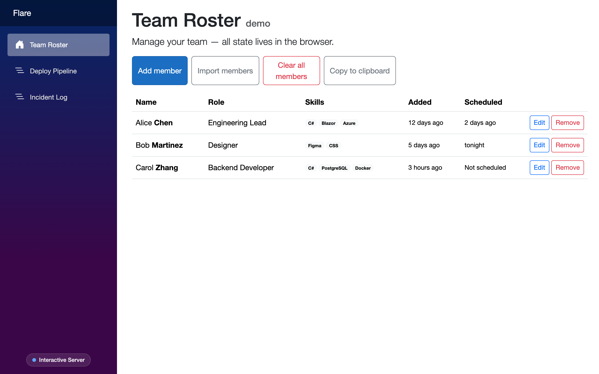
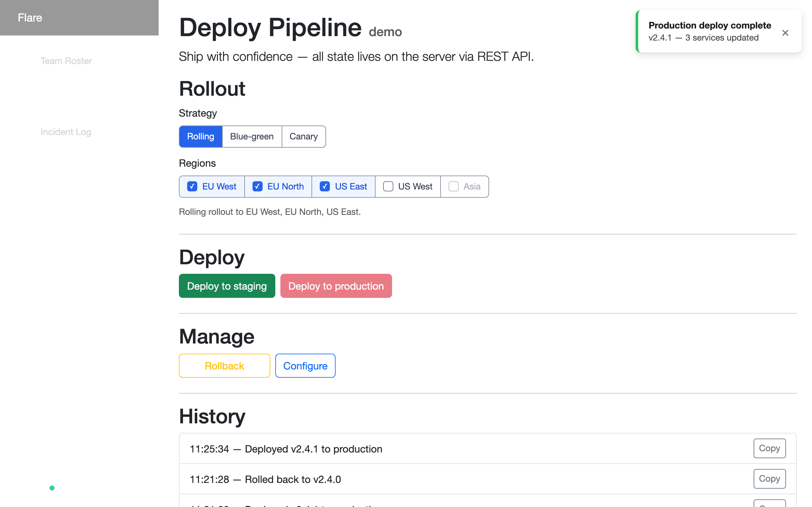
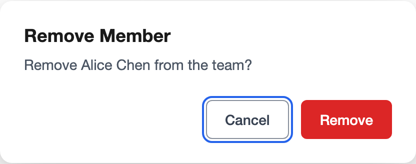
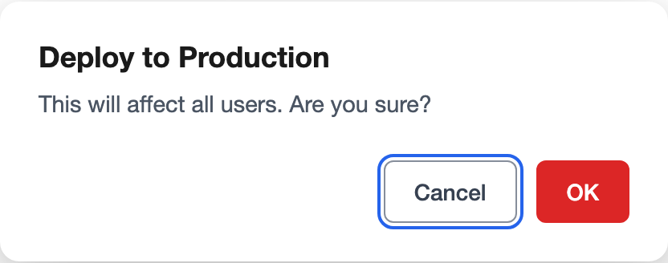
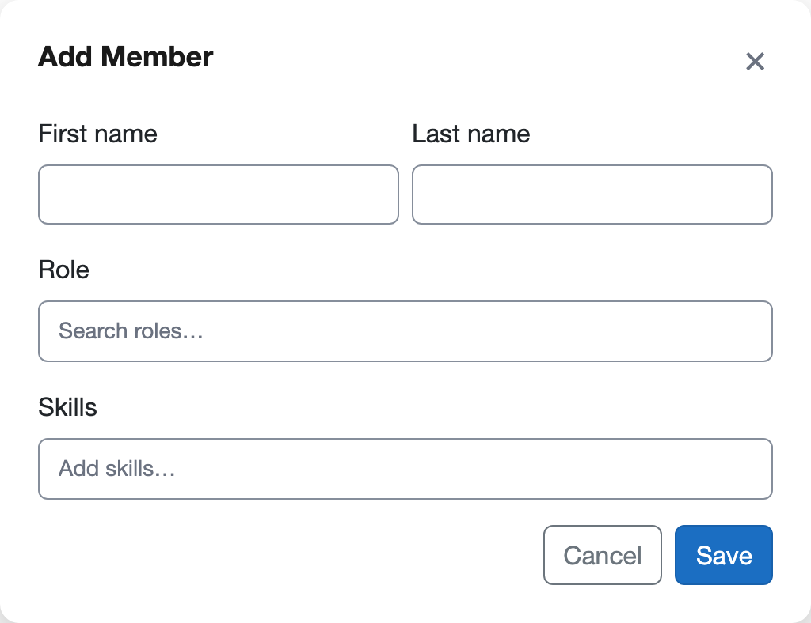
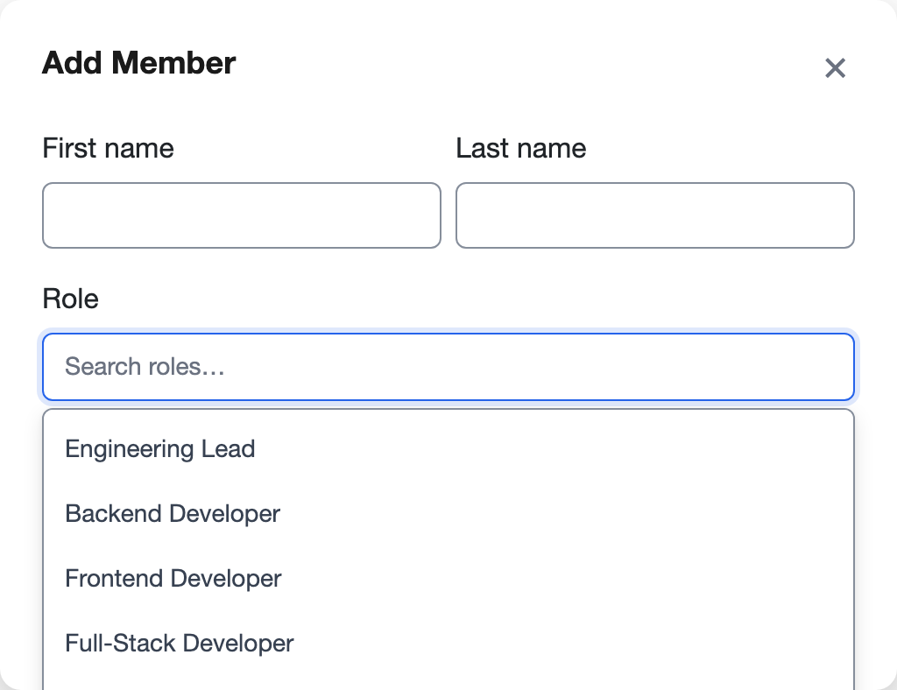
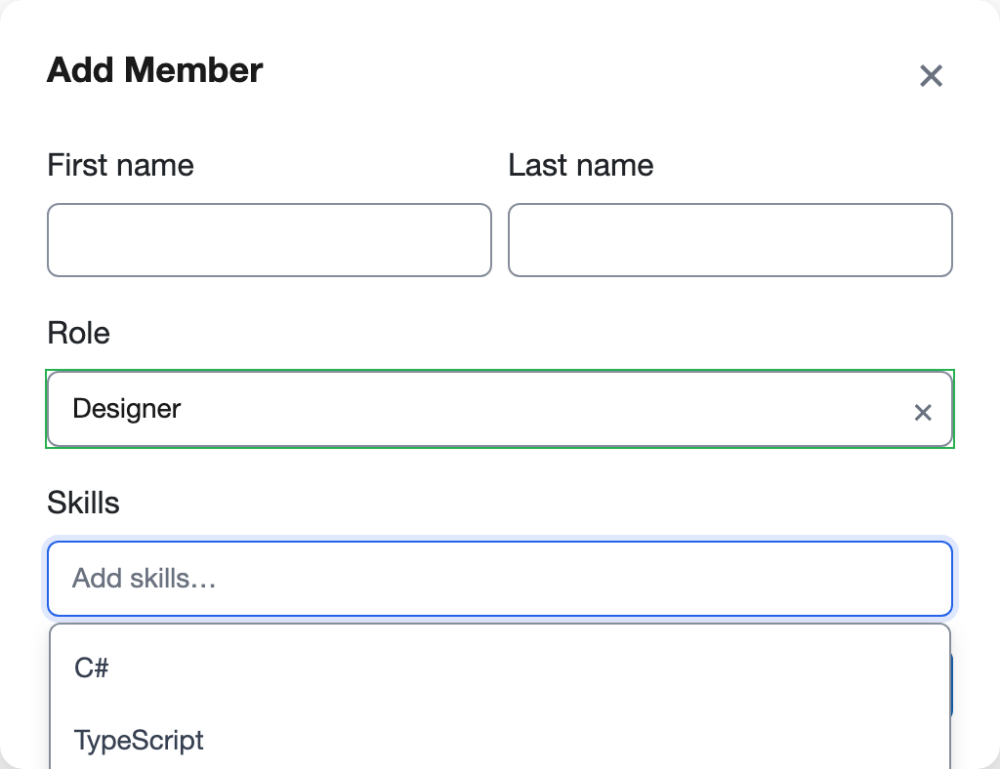
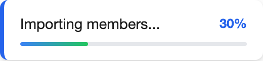

# Flare.UI

Batteries-included Blazor component library for toasts, modals, confirm dialogs, loading bars, loading toasts, typeahead, tag box, clipboard, relative time, relative day, timezone detection, and reusable button primitives — with built-in localization for 25 languages. Zero dependencies.

The sample app wires those pieces into a small team-roster / deploy / incident-log UI:



## Install

```
dotnet add package Flare.UI
```

## Setup

Register the service:

```csharp
builder.Services.AddFlare();
```

Wrap your page (or layout) with `<FlareProvider>`:

```razor
@inject IFlareService Flare

<FlareProvider>
    @* your content *@
</FlareProvider>
```

## Toast

```csharp
await Flare.ToastAsync("Item saved.", ToastLevel.Success);

// With options
await Flare.ToastAsync("Check your input.", new ToastOptions
{
    Level = ToastLevel.Warning,
    DurationMs = 10_000,
    Persistent = true,
});

// Rich content
await Flare.ToastAsync("", new ToastOptions
{
    Level = ToastLevel.Success,
    Content = @<div><strong>Done</strong><div>3 items processed</div></div>,
});
```

That rich-content form is what the demo uses after a production deploy:



```csharp
// Dismiss programmatically
var handle = await Flare.ToastAsync("Working...", new ToastOptions { Persistent = true });
handle.Dismiss();
```

## Confirm

```csharp
var confirmed = await Flare.ConfirmAsync("Delete Item", "This cannot be undone.");

// Custom labels
var confirmed = await Flare.ConfirmAsync("Publish", "Make this visible?", new ConfirmOptions
{
    ConfirmText = "Publish",
    CancelText = "Keep as Draft",
});

// Destructive confirm — red button, Enter defaults to Cancel (safe UX)
var confirmed = await Flare.ConfirmAsync("Delete Item", "This cannot be undone.", new ConfirmOptions
{
    Intent = ConfirmIntent.Danger,
    ConfirmText = "Delete",
});
```

With `Intent.Danger`, Cancel is focused so Enter backs out. The demo uses that in two places:

<table>
<tr>
<td align="center" valign="top">

<p>Remove a teammate</p>
</td>
<td align="center" valign="top">

<p>Ship to production</p>
</td>
</tr>
</table>

`DefaultButton` controls which button receives initial focus. Enter and Space both activate the focused button:
- `ConfirmIntent.Primary` → Confirm is focused → Enter confirms
- `ConfirmIntent.Danger` → Cancel is focused → Enter cancels (prevents accidental destructive actions)

Tab switches focus between buttons. Override the default per-call if needed:

```csharp
new ConfirmOptions { Intent = ConfirmIntent.Danger, DefaultButton = DefaultButton.Confirm }
```

## Modal

<table>
<tr>
<td valign="top">

Any Blazor component can be rendered as a modal. The demo's "Add member" form is one of those — typeahead for the role, tag box for skills. Use the cascading `ModalContext` to return data from it.

</td>
<td valign="top" width="46%">

</td>
</tr>
</table>

```razor
@* EditProfile.razor *@
<div>
    <input @bind="Name" />
    <button @onclick="() => Modal.Ok(Name)">Save</button>
    <button @onclick="Modal.Cancel">Cancel</button>
</div>

@code {
    [CascadingParameter] public ModalContext Modal { get; set; } = default!;
    [Parameter] public string CurrentName { get; set; } = "";
    private string Name = "";
    protected override void OnInitialized() => Name = CurrentName;
}
```

```csharp
var result = await Flare.ModalAsync<EditProfile>(new ModalOptions
{
    Title = "Edit Profile",
    CssClass = "my-wide-modal",
    Parameters = new() { ["CurrentName"] = "Jane" },
});

if (result.Confirmed)
{
    var name = result.GetData<string>();
}
```

Control modal sizing via CSS custom properties on `CssClass`:

```css
.my-wide-modal {
    --flare-modal-min-width: 32rem;
    --flare-modal-width: 40rem;
    --flare-modal-max-width: 90vw;
}
```

## Typeahead

<table>
<tr>
<td valign="top">

A single-value autocomplete control that searches items as the user types. Open the role field in the member modal and it filters as you go.

Keyboard: Arrow keys navigate, Enter selects, Escape/Tab closes.

</td>
<td valign="top" width="46%">

</td>
</tr>
</table>

```razor
@* Client-side filtering *@
<FlareTypeahead TItem="string"
                Items="_roles"
                TextSelector="r => r"
                @bind-Value="SelectedRole"
                Placeholder="Search roles…"
                MinLength="0" />

@* Async search *@
<FlareTypeahead TItem="User"
                SearchFunc="SearchUsers"
                TextSelector="u => u.Name"
                @bind-Value="SelectedUser"
                Placeholder="Search users…" />

@* Free-text creation *@
<FlareTypeahead TItem="string"
                Items="_tags"
                TextSelector="t => t"
                CreateItem="t => t"
                @bind-Value="Tag"
                Placeholder="Type or pick a tag…" />
```

| Parameter | Default | Description |
|---|---|---|
| `Items` | `null` | Static collection to filter client-side (`IEnumerable<TItem>`) |
| `SearchFunc` | `null` | Async search `(string query, CancellationToken ct) → IEnumerable<TItem>` |
| `TextSelector` | *(required)* | Extracts display text from an item |
| `Value` / `ValueChanged` | | Two-way binding for the selected item |
| `ValueExpression` | `null` | Expression for `EditForm` integration (validation + field notifications) |
| `ItemTemplate` | `null` | Custom render template for dropdown items |
| `CreateItem` | `null` | Factory to create a new item from free text |
| `Placeholder` | `null` | Input placeholder |
| `Class` | `null` | CSS class(es) on the root container |
| `DebounceMs` | `300` | Debounce delay before searching |
| `MinLength` | `1` | Minimum characters to trigger search |
| `LoadingText` | `"Searching…"` | Text shown while loading |
| `NotFoundText` | `"No results found"` | Text shown when empty |
| `Disabled` | `false` | Disables the control |
| `Headless` | `false` | Strips all built-in CSS |

## Tag Box

<table>
<tr>
<td valign="top" width="46%">

</td>
<td valign="top">

A multi-select tagging control with typeahead search. Selected items appear as removable tags; the skills field in the same modal is the live example.

Keyboard: Arrow keys navigate, Enter/Comma selects, Backspace removes last tag, Escape closes. Each tag is a button in the tab order; Enter, Space, Delete or Backspace removes the focused tag.

</td>
</tr>
</table>

```razor
@* Client-side with free-text creation *@
<FlareTagBox TItem="string"
             Items="_knownSkills"
             TextSelector="s => s"
             CreateItem="s => s"
             @bind-Values="Skills"
             Placeholder="Add skills…"
             MaxTags="5" />

@* Async search with custom templates *@
<FlareTagBox TItem="User"
             SearchFunc="SearchUsers"
             TextSelector="u => u.Name"
             @bind-Values="TeamMembers"
             Placeholder="Add members…">
    <ItemTemplate>@context.Name — @context.Role</ItemTemplate>
    <TagTemplate>@context.Name</TagTemplate>
</FlareTagBox>
```

| Parameter | Default | Description |
|---|---|---|
| `Items` | `null` | Static collection to filter client-side (`IEnumerable<TItem>`) |
| `SearchFunc` | `null` | Async search `(string query, CancellationToken ct) → IEnumerable<TItem>` |
| `TextSelector` | *(required)* | Extracts display text from an item |
| `Values` / `ValuesChanged` | | Two-way binding for selected items |
| `ValuesExpression` | `null` | Expression for `EditForm` integration (validation + field notifications) |
| `Comparer` | `Default` | Equality comparer for duplicate prevention |
| `ItemTemplate` | `null` | Custom render template for dropdown items |
| `TagTemplate` | `null` | Custom render template for tags |
| `CreateItem` | `null` | Factory to create a new item from free text |
| `Placeholder` | `null` | Input placeholder (hidden when tags exist) |
| `Class` | `null` | CSS class(es) on the root container |
| `DebounceMs` | `300` | Debounce delay before searching |
| `MinLength` | `1` | Minimum characters to trigger search |
| `MaxTags` | `0` | Max selectable items (`0` = unlimited) |
| `LoadingText` | `"Searching…"` | Text shown while loading |
| `NotFoundText` | `"No results found"` | Text shown when empty |
| `Disabled` | `false` | Disables the control |
| `Headless` | `false` | Strips all built-in CSS |

## Check List

A searchable, scrollable multi-select list with virtualized rendering. Uses Blazor's `Virtualize` component — only visible rows are rendered, so it handles 100k+ items with no DOM pressure. Three data modes: static `Items`, async `SearchFunc`, or server-paged `ProviderFunc`.

```razor
@* Client-side with fixed height *@
<FlareCheckList TItem="string"
                Items="_services"
                TextSelector="s => s"
                @bind-Values="SelectedServices"
                Placeholder="Filter services…"
                MaxHeight="16rem"
                ShowCount />

@* Async remote search (loads full result set) *@
<FlareCheckList TItem="UserGroup"
                SearchFunc="SearchGroups"
                TextSelector="g => g.Name"
                @bind-Values="AssignedGroups"
                Placeholder="Search groups…"
                MaxHeight="20rem"
                ShowCount>
    <ItemTemplate>
        <div>
            <strong>@context.Name</strong>
            <div style="font-size: 0.75rem; color: #6b7280;">@context.Description</div>
        </div>
    </ItemTemplate>
</FlareCheckList>

@* Server-side paging — only the visible page is fetched *@
<FlareCheckList TItem="string"
                ProviderFunc="LoadServices"
                TextSelector="s => s"
                @bind-Values="SelectedServices"
                Placeholder="Search services…"
                MaxHeight="16rem"
                ShowCount />

@code {
    private async Task<CheckListResult<string>> LoadServices(
        string filter, int skip, int take, CancellationToken ct)
    {
        var url = $"/api/services?filter={Uri.EscapeDataString(filter)}&skip={skip}&take={take}";
        var page = await Http.GetFromJsonAsync<ServicePage>(url, ct);
        return new CheckListResult<string>(page!.Items, page.TotalCount);
    }
}
```

| Parameter | Default | Description |
|---|---|---|
| `Items` | `null` | Static collection to filter client-side (`IEnumerable<TItem>`) |
| `SearchFunc` | `null` | Async search `(string query, CancellationToken ct) → IEnumerable<TItem>` |
| `ProviderFunc` | `null` | Server-paged provider `(filter, skip, take, ct) → CheckListResult<TItem>` |
| `TextSelector` | *(required)* | Extracts display text from an item |
| `Values` / `ValuesChanged` | | Two-way binding for selected items |
| `ValuesExpression` | `null` | Expression for `EditForm` integration |
| `Comparer` | `Default` | Equality comparer for selection state |
| `KeySelector` | `null` | Extracts a unique key for stable virtual scroll tracking (falls back to `TextSelector`) |
| `ItemTemplate` | `null` | Custom render template for each row |
| `Placeholder` | `null` | Search input placeholder |
| `SearchLabel` | `"Filter"` | Accessible name of the search input |
| `MaxHeight` | `null` | CSS max-height for scroll area (`null` = auto-expand) |
| `ItemSize` | `40` | Row height in px for virtual scroll |
| `DebounceMs` | `300` | Debounce delay before remote search |
| `ShowSearch` | `true` | Show/hide the filter input |
| `ShowCount` | `false` | Show "N selected" footer |
| `SelectedFirst` | `false` | Sort checked items to top |
| `MaxItems` | `0` | Max selectable items (`0` = unlimited) |
| `LoadingText` | `"Loading…"` | Text shown while loading |
| `NotFoundText` | `"No items found"` | Text shown when empty |
| `Disabled` | `false` | Disables the control |
| `Headless` | `false` | Strips all built-in CSS |

Keyboard: Tab moves from the filter to the list. In the list, Arrow keys, Home/End and PageUp/PageDown move the active row, Space or Enter toggles it. Escape clears the filter.

Name the list with `aria-label` or `aria-labelledby` on the component; both are applied to the list element.

## Toggle Bar

A connected bar of segments for a short list of options — one of N by default, any of N with `Multiple`. Single select fills the active segment with the accent colour. Multi select gives every segment its own check box and only tints the active ones, so the state of each option stays readable even when all of them are on.

```razor
@* One of N *@
<FlareToggleBar TItem="string"
                Items="_strategies"
                @bind-Value="_strategy"
                aria-label="Rollout strategy" />

@* Any of N *@
<FlareToggleBar TItem="string"
                Items="_regions"
                Multiple
                @bind-Values="_selectedRegions"
                aria-label="Regions" />

@* Enum options with display text, full width *@
<FlareToggleBar TItem="Severity"
                Items="Enum.GetValues<Severity>()"
                TextSelector="s => s.ToString().ToUpperInvariant()"
                @bind-Value="_severity"
                Stretch />
```

| Parameter | Default | Description |
|---|---|---|
| `Items` | *(required)* | Options in display order (`IEnumerable<TItem>`) |
| `Multiple` | `false` | `false` = one of N (`Value`), `true` = any of N (`Values`) |
| `Value` / `ValueChanged` | | Two-way binding for the selected option (single select) |
| `Values` / `ValuesChanged` | | Two-way binding for the selected options (multi select), in `Items` order |
| `ValueExpression` / `ValuesExpression` | `null` | Expression for `EditForm` integration |
| `TextSelector` | `ToString()` | Extracts display text from an option |
| `Comparer` | `Default` | Equality comparer for selection state |
| `ItemTemplate` | `null` | Custom render template for the segment content |
| `ItemDisabled` | `null` | Returns `true` for options the user cannot change; a locked segment still shows its state |
| `ItemTitle` | `null` | Returns the tooltip (`title`) for an option's segment |
| `Stretch` | `false` | Fill the available width with equally wide segments |
| `Wrap` | `false` | Wrap segments onto further rows when they do not fit (default: shorten labels with an ellipsis) |
| `Disabled` | `false` | Disables the whole control |
| `Headless` | `false` | Strips all built-in CSS; the native inputs stay visible |

The segments are native radio buttons or checkboxes. Keyboard: Tab moves into the bar; in single select the arrow keys change the option, in multi select Tab moves between segments and Space toggles. Other attributes such as `aria-label` are passed to the root element.

`TItem` has to be given explicitly when `ValueChanged` / `ValuesChanged` is a lambda; C# cannot infer it from there.

Look and size are set with CSS variables, on the bar itself or any ancestor:

| Variable | Default | Applies to |
|---|---|---|
| `--flare-togglebar-accent` / `-accent-hover` | `#2563eb` / `#1d4ed8` | Active segment (single select), check box, focus ring |
| `--flare-togglebar-accent-text` | `#fff` | Text on the active segment (single select) |
| `--flare-togglebar-tint` / `-tint-hover` / `-tint-text` | `#eff6ff` / `#dbeafe` / `#1d4ed8` | Active segments (multi select) |
| `--flare-togglebar-bg` / `-hover` | `#fff` / `#f3f4f6` | Bar background, hover on inactive segments |
| `--flare-togglebar-text` | `#374151` | Text of inactive segments |
| `--flare-togglebar-border` | `#868e9b` | Outer border and dividers |
| `--flare-togglebar-radius` | `0.375rem` | Corner radius |
| `--flare-togglebar-font-size` | `0.875rem` | Label size |
| `--flare-togglebar-padding` | `0.375rem 0.75rem` | Segment padding, and with it the height of the bar |

## EditForm Integration

`FlareTypeahead`, `FlareTagBox`, `FlareCheckList`, and `FlareToggleBar` integrate with Blazor's `EditForm`. When used inside an `EditForm`, `@bind-Value` / `@bind-Values` automatically generates the expression parameter. The component picks up the cascading `EditContext`, notifies field changes on selection, and applies validation CSS classes (`modified`, `valid`, `invalid`).

```razor
<EditForm Model="_model" OnValidSubmit="Save">
    <DataAnnotationsValidator />

    <FlareTypeahead TItem="string"
                    Items="_roles"
                    TextSelector="r => r"
                    @bind-Value="_model.Role"
                    Placeholder="Pick a role…" />
    <ValidationMessage For="() => _model.Role" />

    <FlareTagBox TItem="string"
                 Items="_skills"
                 TextSelector="s => s"
                 @bind-Values="_model.Skills"
                 Placeholder="Add skills…" />
    <ValidationMessage For="() => _model.Skills" />
</EditForm>
```

No `InputBase<T>` inheritance — the existing API stays intact.

## Loading Bar

Declarative:

```razor
<FlareLoadingBar Active="_loading" Fixed />
<FlareLoadingBar Active="_loading" Progress="_percent" />
```

Screen readers announce the bar as "Loading"; set `AriaLabel` to say what is loading.

Imperative:

```csharp
using var _ = Flare.StartLoadingBar();       // shows after 1500ms delay
await SomeWork();                             // bar auto-hides on dispose

using var _ = Flare.StartLoadingBar(delayMs: 0);  // shows immediately
```

Colors are customizable via CSS variables on `:root` (or any ancestor):

```css
--flare-loading-bar-color: #3b82f6;      /* first gradient stop; set only this for a solid color */
--flare-loading-bar-color-alt: #22c55e;  /* second gradient stop */
--flare-loading-bar-background: ...;     /* optional full background override */
```

## Loading Toast

<table>
<tr>
<td valign="top">

Indeterminate, or with a percent. The demo shows this while importing members:

```csharp
using var _ = Flare.StartLoadingToast("Processing...");
await SomeWork();

var toast = Flare.StartLoadingToast("Uploading...", delayMs: 0);
for (var i = 0; i <= 100; i += 10)
{
    toast.Update(progress: i);
    await Task.Delay(100);
}
toast.Dispose();
```

</td>
<td valign="middle">

</td>
</tr>
</table>

The bar uses the same `--flare-loading-bar-*` colors by default. Override independently:

```css
--flare-loading-toast-color: #3b82f6;
--flare-loading-toast-color-alt: #22c55e;
--flare-loading-toast-background: ...;   /* optional full fill override */
--flare-loading-toast-track: #e5e7eb;    /* unfilled track */
--flare-loading-toast-accent: #2563eb;   /* left border + percent label */
```

Regular toasts also have a countdown bar. It follows the toast accent, or `--flare-toast-progress` if set:

```css
--flare-toast-info: #3b82f6;
--flare-toast-success: #22c55e;
--flare-toast-warning: #f59e0b;
--flare-toast-error: #ef4444;
--flare-toast-progress: ...;             /* optional override for the countdown bar only */
```

## Confirm Button

A two-stage confirmation button that prevents accidental destructive actions. Supports timed mode (arm → confirm) and modal mode (opens a Flare confirm dialog).

```razor
@* Timed mode — first click arms, second click confirms *@
<FlareConfirmButton class="btn btn-danger" ArmedClass="btn-warning"
                    OnConfirmed="HandleDelete">
    <Standby>Delete record</Standby>
    <Armed>Confirm delete</Armed>
</FlareConfirmButton>

@* Modal mode — opens a Flare confirm dialog *@
<FlareConfirmButton class="btn btn-danger" UseModal
                    ModalHeading="Purge Cache"
                    ModalMessage="This will invalidate all cached entries. Continue?"
                    OnConfirmed="HandlePurge">
    <Standby>Purge cache</Standby>
</FlareConfirmButton>
```

By default the button permanently disables after confirmation. Set `DisableOnConfirm="false"` for repeatable actions:

```razor
<FlareConfirmButton class="btn" StandbyClass="btn-outline-warning" ArmedClass="btn-warning"
                    DisableOnConfirm="false" OnConfirmed="Rollback">
    <Standby>Rollback</Standby>
    <Armed>Confirm rollback</Armed>
</FlareConfirmButton>
```

| Parameter | Default | Description |
|---|---|---|
| `Standby` | *(required)* | Content in default state |
| `Armed` | `"Confirm"` | Content in armed state |
| `OnConfirmed` | | Fires on confirmed action |
| `UseModal` | `false` | Use confirm dialog instead of timed mode |
| `ModalHeading` | `"Confirm"` | Dialog title (modal mode) |
| `ModalMessage` | `null` | Dialog body (modal mode) |
| `ArmedClass` | `null` | CSS class merged when armed |
| `StandbyClass` | `null` | CSS class merged while not armed; use it when the armed class must replace a variant (e.g. Bootstrap `btn-outline-*` → `btn-*`) instead of adding to it |
| `ArmDelayMs` | `2000` | Disabled wait before arming |
| `ArmedWindowMs` | `8000` | Time window to confirm before reset |
| `DisableOnConfirm` | `true` | Permanently disable after confirmation |

## Debounced Button

Prevents double-click and rapid-fire submits by disabling the button for a cooldown period after each click.

```razor
<FlareDebouncedButton class="btn btn-primary" OnAction="Save">
    Save changes
</FlareDebouncedButton>

<FlareDebouncedButton class="btn btn-success" Timeout="TimeSpan.FromSeconds(3)" OnAction="Submit">
    Submit
</FlareDebouncedButton>
```

| Parameter | Default | Description |
|---|---|---|
| `ChildContent` | *(required)* | Button content |
| `OnAction` | *(required)* | Fires on click |
| `Timeout` | `1s` | Cooldown period |

## Clipboard Button

Copies a string to the system clipboard and shows success/error feedback via Flare toast.

```razor
<FlareClipboardButton class="btn btn-outline-secondary" Value="@SomeText" />

<FlareClipboardButton class="btn btn-sm btn-outline-primary" Value="@ApiKey">
    Copy API key
</FlareClipboardButton>
```

| Parameter | Default | Description |
|---|---|---|
| `Value` | `null` | Text to copy |
| `ChildContent` | `"Copy to clipboard"` | Custom button content |
| `OnCopied` | | Fires after copy attempt (`bool` success) |

## Clipboard Inline

Renders inline content that copies its text to the clipboard on click, or on Enter/Space when focused — it is a button in the tab order. Shows a "Copy" tooltip on hover and focus with a pointer cursor. No default styling — bring your own classes.

```razor
<FlareClipboard Class="text-monospace">@user.ID</FlareClipboard>

<FlareClipboard>@user.FirstName <b>@user.LastName</b></FlareClipboard>
```

When no `Value` is set, the component reads the rendered text content from the DOM — so mixed markup (like bold text) is copied as plain text automatically.

| Parameter | Default | Description |
|---|---|---|
| `ChildContent` | | Content to display (also the copied text) |
| `Value` | `null` | Explicit text to copy (overrides text extraction) |
| `Class` | `null` | CSS class(es) on the wrapping `<span>` |

Tooltip colors are customizable via CSS variables:

```css
--flare-tooltip-bg: #333;
--flare-tooltip-color: #fff;
```

## Configuration

```csharp
builder.Services.AddFlare(o =>
{
    o.ToastPosition = ToastPosition.BottomRight;
    o.MaxToasts = 3;
    o.Headless = true; // strip all default styles
    o.Locale = "de-de"; // BCP 47 tag (default: "en-us")
    o.Debug = builder.Environment.IsDevelopment(); // verbose JS logging

    // Toast defaults
    o.Toast.DurationMs = 4000;
    o.Toast.ShowProgress = false;

    // Modal defaults
    o.Modal.CloseOnBackdropClick = false;
    // Confirm defaults
    o.Confirm.Intent = ConfirmIntent.Primary;
    o.Confirm.ConfirmText = "OK";      // default: localized "OK" of o.Locale
    o.Confirm.CancelText = "Cancel";   // default: localized "Cancel" of o.Locale
});
```

> **WASM note:** In a Blazor WebAssembly project, use `builder.HostEnvironment.IsDevelopment()` instead.

Per-call options override global defaults. Unset properties fall back to the configured defaults.

## Relative Time

Displays a UTC timestamp as a live-updating relative time string. Formatting runs entirely in the browser via JS — zero SignalR overhead. Shows the absolute timestamp as a tooltip.

```razor
<FlareRelativeTime Value="@item.CreatedUtc" />
```

Renders output like "just now", "5 minutes ago", "in 2 hours", "3 days ago".

Updates automatically — 1-second ticks while any element is in seconds range, 10-second ticks otherwise. Pauses when the tab is hidden.

The tooltip with the absolute time shows on hover and on tap. To make it reachable by keyboard and announced by screen readers, put the element into the tab order with `Focusable` — per component, or for all relative time and day components with `o.RelativeTimeFocusable = true`. It is off by default, because every timestamp in a table would become a tab stop.

```razor
<FlareRelativeTime Value="@item.CreatedUtc" Focusable />
```

## Relative Day

Displays a UTC timestamp relative to the current day, focused on day granularity with an optional night indicator (23:00–05:59).

```razor
<FlareRelativeDay Value="@item.ScheduledUtc" />
```

Renders output like "earlier today", "tonight", "tomorrow night", "last night", "in 3 days".

Night phrasing is human-oriented rather than calendar-oriented: from daytime, the upcoming night is labeled "tonight", including times after midnight such as 01:00 or 03:00 on the next calendar day.

**Expectation model**

- Daytime is `06:00–22:59`
- Nighttime is `23:00–05:59`
- Daytime labels are calendar-based: `earlier today`, `today`, `tomorrow`, `yesterday`
- Night labels are night-period-based: `earlier tonight`, `tonight`, `last night`, `tomorrow night`

| Now | Target | Expected |
|---|---|---|
| day | later same day, daytime | `today` |
| day | later same day, night | `tonight` |
| day | next calendar day, `00:00–05:59` | `tonight` |
| day | next calendar day, daytime | `tomorrow` |
| day | next distinct night period | `tomorrow night` |
| day | previous night period | `last night` |
| night | earlier in same continuous night | `earlier tonight` |
| night | later in same continuous night | `tonight` |
| night | next daytime | `today` or `tomorrow`, depending on calendar day |
| night | previous distinct night period | `last night` |

Examples:

| Now | Target | Expected |
|---|---|---|
| `2026-06-15 14:00` | `2026-06-16 00:30` | `tonight` |
| `2026-06-15 14:00` | `2026-06-16 03:00` | `tonight` |
| `2026-06-15 14:00` | `2026-06-16 23:30` | `tomorrow night` |
| `2026-06-15 14:00` | `2026-06-15 03:00` | `last night` |
| `2026-06-16 03:00` | `2026-06-15 23:00` | `earlier tonight` |
| `2026-06-16 03:00` | `2026-06-16 12:00` | `today` |

## Timezone

Detects the client's IANA timezone and converts UTC timestamps to client-local time. Useful when you need formatted dates rather than relative strings.

```csharp
@inject IFlareTimezoneService Tz

@if (Tz.IsInitialized)
{
    <span>@Tz.ToClientTime(item.CreatedUtc).ToString("yyyy-MM-dd HH:mm")</span>
    <span>Timezone: @Tz.IanaTimezone</span>
}
```

The service initializes automatically when `<FlareProvider>` renders on the client.

## Theming

Every color of the built-in styles is a CSS variable. Set the shared tokens on `:root` (or any ancestor) to restyle all components at once, for example for a dark theme or higher contrast:

```css
:root {
    --flare-bg: #1f2937;
    --flare-text: #f9fafb;
    --flare-border: #6b7280;
    --flare-accent: #60a5fa;
}
```

| Token | Default | Used for |
|---|---|---|
| `--flare-bg` / `--flare-bg-subtle` | `#fff` / `#f9fafb` | Surfaces; search field, footer and disabled inputs |
| `--flare-text` | `#1a1a1a` | Primary text |
| `--flare-text-secondary` | `#374151` | Options, default buttons |
| `--flare-text-muted` | `#6b7280` | Loading and empty states, footers |
| `--flare-text-faint` | `#6b7280` | Placeholders, close and clear icons |
| `--flare-border` / `--flare-border-subtle` | `#868e9b` / `#e5e7eb` | Outer borders; inner dividers |
| `--flare-hover` | `#f3f4f6` | Hover background |
| `--flare-accent` / `--flare-accent-hover` | `#2563eb` / `#1d4ed8` | Primary button, checked boxes, focus rings |
| `--flare-accent-text` | `#fff` | Text on accent and danger backgrounds |
| `--flare-tint` / `--flare-tint-hover` | `#eff6ff` / `#dbeafe` | Selected rows, tags, highlighted option |
| `--flare-tint-text` / `--flare-tint-border` | `#1d4ed8` / `#bfdbfe` | Text and border on tinted backgrounds |
| `--flare-danger` / `--flare-danger-hover` | `#dc2626` / `#b91c1c` | Danger confirm button |
| `--flare-backdrop` | `rgba(0, 0, 0, 0.4)` | Modal and confirm backdrop |

Each token can be overridden for a single component by inserting its name: `--flare-<component>-<token>`, with `checklist`, `confirm`, `modal`, `tagbox`, `typeahead`, `toast`, `loading-toast` or `togglebar` as the component — for example `--flare-confirm-accent` or `--flare-tagbox-border`. The component variable wins over the shared token.

A few variables exist only per component: `--flare-confirm-message` (message text, `#4b5563`), `--flare-typeahead-focus-ring` / `--flare-tagbox-focus-ring` (focus glow, 15% of the accent), `--flare-togglebar-check-border`, `--flare-toast-focus` (focus ring of toast buttons, defaults to the accent), plus the ones listed under [Toggle Bar](#toggle-bar), [Loading Bar](#loading-bar) and the toast level colors `--flare-toast-info` / `-success` / `-warning` / `-error`. Note that `--flare-togglebar-text` falls back to `--flare-text-secondary`. The toast level colors, the loading toast accent and the loading bar gradient do not follow `--flare-accent`; set their own variables. Shadows are not variables.

## Accessibility

The components follow the WAI-ARIA Authoring Practices patterns and are fully keyboard operable:

- **Dialogs** (modal, confirm) trap focus, return it to the opener and close on Escape. A modal without a title is named by `ModalOptions.AriaLabel`.
- **Typeahead and tag box** are comboboxes with a listbox popup; the **check list** is a multi-select listbox, also when virtualized.
- **Toasts** are live regions (`alert` for errors, `status` otherwise). The dismiss timer pauses while keyboard focus is inside a toast.
- **Tooltips** on focusable elements (such as the inline clipboard) appear on focus as well as hover, are announced as the description of the focused element and close on Escape. The absolute-time tooltip of `FlareRelativeTime` / `FlareRelativeDay` sits on plain text; set `Focusable` (or `RelativeTimeFocusable` globally) to include it.
- **Reduced motion:** with `prefers-reduced-motion: reduce`, slide, scale and shimmer animations are off.
- **Forced colors** (Windows high contrast): selection, focus and progress stay visible through system colors.
- Built-in labels and status texts ("Close", "Loading…", "No results found", …) follow the configured [locale](#localization).

What stays with you: give inputs a label (attributes such as `aria-label` or `id` pass through to the input of typeahead and tag box), name check lists and toggle bars with `aria-label`, and check color contrast when you change the theme. The default palette meets the WCAG AA contrast ratios (4.5:1 for text, 3:1 for input borders, check boxes and focus rings) on the default backgrounds.

Next to Bootstrap fields the Flare inputs look darker, because Bootstrap's own field border (`#dee2e6`) is below 3:1. Either darken Bootstrap's (`.form-control, .form-select { border-color: var(--flare-border, #868e9b); }`) or, if you accept the lower contrast, set `--flare-border: var(--bs-border-color)`.

In `Headless` mode all roles, states and keyboard handling remain; the focus styles are yours to provide. The active check list row is marked with `data-flare-active`.

## Localization

Flare ships 25 locale files using BCP 47 tags. Set the locale at startup:

```csharp
builder.Services.AddFlare(o => o.Locale = "ja-jp");
```

**Included locales:** en-us, en-gb, de-de, de-at, de-ch, fr-fr, es-es, it-it, pt-br, nl-nl, pl-pl, ja-jp, ko-kr, zh-cn, tr-tr, ru-ru, sv-se, nb-no, da-dk, fi-fi, cs-cz, uk-ua, ar-sa, hi-in, th-th.

**Fallback resolution:** exact tag → base language (e.g. `de` → `de-de`) → `en-us`.

Locale files are JSON in `wwwroot/locales/`. During server prerender, strings are read from embedded resources. On the client, the matching JSON file is fetched at runtime.

Besides the `time` section, each file has a `ui` section with the built-in labels and status texts (close, dismiss, loading, no results, copy, OK/Cancel, …). Parameters such as `LoadingText` or `ConfirmText` still override them per component or call. A key missing from a locale falls back to `en-us`.

The relative-day locale contract includes dedicated keys for person-friendly night phrasing such as `earlierTonight`, `tonight`, `tomorrowNight`, and `lastNight`, with `nightFormat` used only for longer ranges like "in 3 days at night".

## License

[MIT](LICENSE)

---

Built with [Claude Code](https://claude.ai/claude-code) using Claude Opus 4.6 by Anthropic
